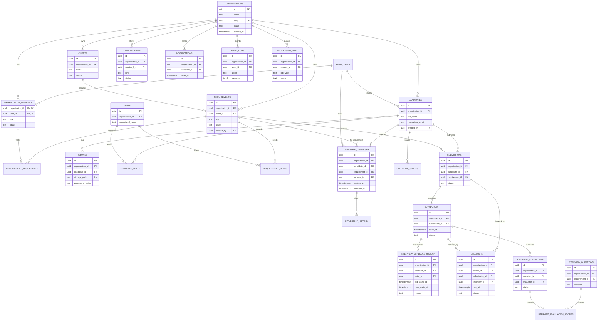

# SEARCHY — Entity Relationship Diagram

The diagram omits some audit and lifecycle columns for readability. All tenant-owned records use `organization_id`; composite tenant foreign keys are defined in the migrations.

`AUTH_USERS` is Supabase's managed `auth.users` table and is not created by SEARCHY migrations. Several entity references are omitted to keep the view legible; see [DATABASE_DESIGN.md](./DATABASE_DESIGN.md).
