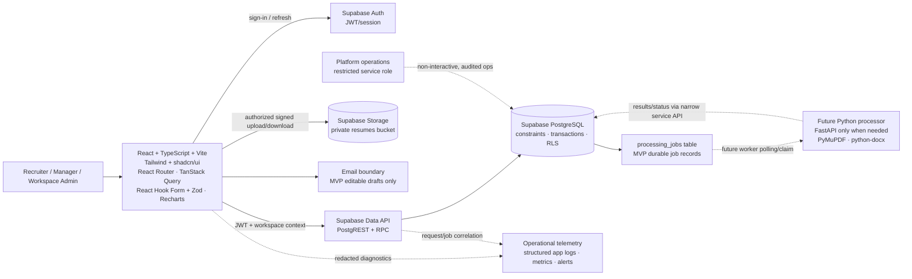

# SEARCHY — System Design

| Field | Value |
| --- | --- |
| Version | 1.0.0 |
| Status | Proposed architecture aligned with [PRD](./PRD.md) |
| Scope | Architecture and integration boundaries; not an application implementation |

## 1. Design goals and scope

SEARCHY is a multi-tenant SaaS for recruitment consultancies. The initial system favors a simple React + Supabase architecture: a TypeScript single-page application talks to Supabase Auth, PostgREST, PostgreSQL, and private Supabase Storage. Critical invariants live in PostgreSQL constraints and narrowly scoped RPC functions. There is no separate API server for ordinary CRUD.

The design provides tenant isolation, clear role-scoped access, durable workflow history, retryable processing, explainable candidate matching, and provider-independent extension points. It does not assume a recruitment-platform connector, outbound email, paid AI API, or a separately deployed FastAPI service.

## 2. Component architecture

Editable drafts can be saved to `communications`; this does not connect to a mailbox. The future worker box is deliberately optional and should be introduced only when production-quality PDF/DOCX extraction or another Python-dependent capability is selected.

## 3. Frontend architecture

- **React + TypeScript + Vite:** single-page application, typed domain models, build-time checks.
- **React Router:** routes for workspace selection, recruiter work queue, REC, candidate, submission, interviews, follow-ups, analytics, and administration. Route guards improve UX but are not authorization controls.
- **TanStack Query:** Supabase query/RPC wrappers, caching, invalidation after state changes, cancellation, and explicit loading/error states.
- **React Hook Form + Zod:** accessible guided forms and client-side input feedback. The database remains authoritative for validation and concurrent business rules.
- **Tailwind + shadcn/ui + Lucide:** consistent low-friction UI primitives, clear status displays, keyboard support.
- **Recharts:** role-scoped operational dashboards using bounded, server-filtered aggregates.
- Keep Supabase access behind typed service modules (e.g. requirements, candidates, submissions); UI components do not construct ad hoc SQL or reuse a service-role key.
- Use the authenticated user's active organization membership as workspace context. Any organization identifier from a route/body is checked against that membership by RLS/RPC.

## 4. Backend and database architecture

Supabase provides Auth, PostgreSQL, Storage, and Data API. Normal reads/writes use the Supabase client with the user's JWT and database RLS. Critical multi-row or race-sensitive operations use SQL functions called through `/rest/v1/rpc/...`.

The schema uses `organizations` as tenant root and repeats `organization_id` on tenant-owned tables. Composite foreign keys include organization ID to prevent cross-tenant references even if application code supplies unrelated IDs. Constraints enforce active ownership and unique candidate/REC submission. See [DATABASE_DESIGN.md](./DATABASE_DESIGN.md) and [database/migrations/](../database/migrations/).

Do not expose a Supabase `service_role` key in the browser. Restrict its use to trusted deployment operations requiring explicit privileged access. It bypasses RLS and must be treated as a production secret.

## 5. Authentication and authorization

Supabase Auth handles identity, password/session lifecycle, and JWT issuance. `auth.users` is the canonical identity table; `organization_members` stores organization-specific role and membership state. A user selects an active organization; the app sends that context, while PostgreSQL independently verifies that the authenticated `auth.uid()` is an active member.

Roles: `recruiter`, `manager`, `workspace_admin`. Platform Super Administrator is an operational identity, not a workspace membership role; platform operations must use a separate restricted control plane. Database RLS is deny-by-default. Client route checks are only presentation. Exact visibility boundaries are in [USER_ROLES.md](./USER_ROLES.md).

Role changes/deactivation are read from membership state on every RLS-protected request, so stale JWT role claims do not grant continuing access. Privileged SQL functions derive actor identity from `auth.uid()`, never a caller-provided actor ID. Authorization helpers live in the `searchy_private` schema; configure Supabase API exposed schemas to exclude it.

## 6. API communication

1. The frontend authenticates with Supabase Auth.
2. The Supabase client sends the user's access token to PostgREST and Storage.
3. RLS policies scope data to `auth.uid()` and the selected organization.
4. Simple CRUD uses filtered table endpoints.
5. Atomic actions (reserve/release candidate, submit, transition requirement) use database RPCs.
6. Long work is represented as a `processing_jobs` row and is not executed synchronously inside a user request.

Detailed endpoint/operation contracts and errors are in [API_CONTRACTS.md](./API_CONTRACTS.md).

## 7. Resume upload and processing

The `resumes` bucket is private. The client asks the database for an upload authorization (or uses authenticated Storage policies) and uploads to an opaque, tenant/candidate-scoped object key. Metadata is written only after authorization; the browser never chooses an arbitrary storage owner or downloads by public URL.

Validate file size, claimed and actual content type, PDF/DOCX structure, and malware policy; use generated object keys; restrict downloads; keep original bytes immutable. Upload and metadata updates must be recoverable if one step fails. A resume record moves through explicit states such as `uploaded`, `queued`, `processing`, `review_ready`, `failed`, `deleted`. Resume text and files are PII and are excluded from logs.

MVP supports manual correction and records processing status. No parsing vendor is mandatory. When parser quality and expected load justify it, introduce a Python worker using PyMuPDF and python-docx (and Pandas only for relevant tabular imports). A durable queue/job table, bounded retries, lease/claim timeout, idempotency key, and failure state decouple this processor. FastAPI is introduced only if the selected processor needs a separately callable Python service; a worker can consume jobs without a public FastAPI API.

## 8. Candidate matching

The MVP matcher is a versioned, deterministic criteria scorer. It receives approved REC criteria and permitted candidate fields, applies explicit skill/experience/location criteria, and returns criterion-level evidence plus matched/missing/unknown data. It does not make rejection or hiring decisions.

Start with PostgreSQL indexes and simple structured/text matching. Store `matching_runs` and bounded `matching_results` if needed for reproducibility; mark results stale when inputs change. RapidFuzz can be evaluated for a review-only fuzzy duplicate signal, never automatic person merging. Sentence Transformers/vector search is future scope only after pilot relevance evaluation, bias review, privacy approval, and cost justification. It is not required for baseline operation.

## 9. Background jobs

Supabase/PostgreSQL stores job metadata and state (`queued`, `running`, `succeeded`, `failed`, `cancelled`), attempt count, schedule/lease, and correlation ID. A job handler must claim work atomically, be idempotent, use bounded exponential backoff, and expose terminal failures. For MVP volumes, a scheduled Edge Function or trusted worker can poll/claim jobs. Do not hold database transactions open while parsing a file or invoking model code.

If volume/latency warrants, move job delivery to a managed queue while retaining database state as source of truth. No queue vendor is a product requirement.

## 10. Email and calendar boundaries

MVP stores editable draft content and interview schedule records. It does not send email, sync mailboxes, or create calendar invitations. Future integrations must be separate adapters with explicit customer authorization, least-privilege scopes, token protection, revocation, retries, deduplication, and delivery audit status. Integration failure must not roll back a candidate/REC state change.

## 11. Error handling

- Validate shape and user input in the UI for usability, and again in database constraints/RPC for integrity.
- Return stable operation-level errors for validation (`VALIDATION_ERROR`), authorization (`FORBIDDEN`), not found/non-disclosing (`NOT_FOUND`), uniqueness/concurrency (`CONFLICT`), throttling (`RATE_LIMITED`), and retryable server/job failures (`INTERNAL`/`PROCESSING_FAILED`).
- Treat PostgreSQL unique/foreign-key/check violations as expected domain conflicts where appropriate; map them to safe messages, not raw SQL.
- Keep user-entered forms intact on failure; never display a success state when persistence did not complete.
- Retry only idempotent actions; claim and submit operations use idempotency keys or database-enforced uniqueness.
- Do not leak cross-tenant existence, raw resume text, stack traces, JWTs, or provider secrets.

## 12. Logging and monitoring

Emit structured application and worker logs with request/job correlation IDs, workspace ID only where appropriate, actor ID, action, result, and latency. Redact candidate PII, email bodies, resume content, access tokens, and signed URLs. Audit logs capture sensitive business actions separately from diagnostic logs. Monitor API latency/errors, DB connections/slow queries, Storage usage, job age/failures, auth denials, and backup/restore. Alerting and retention should follow [NON_FUNCTIONAL_REQUIREMENTS.md](./NON_FUNCTIONAL_REQUIREMENTS.md).

## 13. Deployment architecture

- GitHub stores source and migrations; CI runs lint/type checks, SQL migration validation, unit/integration/RLS tests, and build.
- Vite frontend is a static build deployed to a static hosting/CDN provider over HTTPS. No provider is mandated.
- Supabase project has separate development, staging, and production environments; migration changes are reviewed and applied in order.
- Configure redirect URLs, CORS, Auth policies, Storage limits, backups, and secrets per environment.
- Prefer backward-compatible expand/migrate/contract schema changes; test migrations against a clean database and a staging data copy.
- Avoid placing candidate data in browser analytics, error reporting, test fixtures, or preview deployments.

## 14. Decisions and trade-offs

- **No FastAPI initially:** Supabase meets ordinary CRUD/Auth/Storage needs; a Python processing service is a future boundary, not a prerequisite.
- **Workflow-scoped reservation:** unique active claim is per `(organization, candidate, requirement)`; different RECs may have different owners. This follows the PRD's per-REC working assumption and the explicit ability to consider a candidate for different requirements.
- **Reservation duration:** proposed 7-day lease with explicit renewal/release and manager reassignment; expiry is resolved transactionally on the next claim attempt. This is a proposed operational default requiring pilot validation.
- **No email/source integrations:** preserve the approved PRD boundary; do not imply Naukri or other platform access.

---

*See [ARCHITECTURE_DIAGRAM.md](./ARCHITECTURE_DIAGRAM.md) and [ER_DIAGRAM.md](./ER_DIAGRAM.md) for standalone diagrams.*
